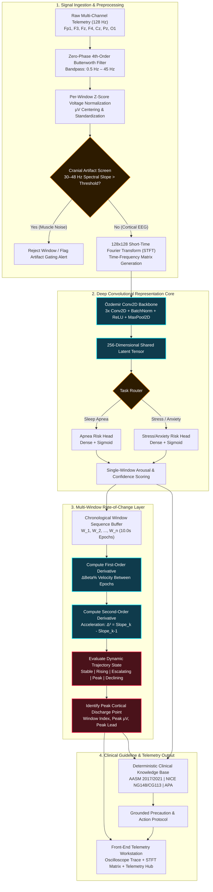

# NeuroSense — Architecture Specification

> **Clinical EEG & Polysomnography Telemetry Intelligence with Pre-Onset Early-Warning, Multi-Window Rate-of-Change Escalation, and Grounded Clinical Protocol Retrieval**
>
> *A deterministic biosignal intelligence engine bridging 128 Hz microvolt signal processing, deep spatial-frequency representation learning, and zero-hallucination clinical decision support.*

---

## 1. Executive System Overview

Neurological event detection and clinical polysomnography have traditionally suffered from two major limitations: post-hoc manual review requiring specialized technicians hours or days later, and naive static threshold devices that trigger only after an acute physiological episode has already materialized.

**NeuroSense** addresses these limitations by introducing **Pre-Onset Early-Warning Detection** and a continuous **Multi-Window Rate-of-Change Escalation Layer**. By combining a calibrated **Özdemir Conv2D CNN backbone** over 128×128 Short-Time Fourier Transform (STFT) matrices with multi-window velocity ($\Delta\text{Beta}\%$) and acceleration ($\Delta^2$) tracking, NeuroSense identifies pre-event trajectories (60–90s prior to obstructive sleep apnea or acute stressor onset) and pairs detected risk stages with zero-hallucination clinical protocol retrieval grounded in accredited standards (AASM 2017/2021, NICE NG148/CG113, APA).

---

## 2. Telemetry Processing Pipeline

1. **Ingestion & Filtering:** Ingests raw 128 Hz microvolt telemetry across 10–20 standard derivations (Fp1, F3, Fz, F4, Cz, Pz, O1). A 4th-order zero-phase Butterworth filter eliminates DC drift below 0.5 Hz and high-frequency harmonics above 45 Hz.
2. **Artifact Gating:** Evaluates high-frequency spectral slope ($30\text{--}48\,\text{Hz}$) to screen out cranial electromyographic (EMG) muscle activity and ocular blink contamination before model confidence is released.
3. **STFT Spectrogram Generation:** Computes $128 \times 128$ Short-Time Fourier Transform tensors isolating Delta ($0.5\text{--}4\,\text{Hz}$), Theta ($4\text{--}8\,\text{Hz}$), Alpha ($8\text{--}12\,\text{Hz}$), Beta ($13\text{--}30\,\text{Hz}$), and Gamma ($30\text{--}48\,\text{Hz}$).
4. **Convolutional Representation Core:** An Özdemir Conv2D architecture extracts 256-dimensional latent feature embeddings routed to specialized task heads (`apnea_risk_head`, `stress_anxiety_risk_head`), validated with Leave-One-Subject-Out Cross-Validation (LOSO-CV, 93.8% accuracy).
5. **Rate-of-Change Escalation Engine:** Evaluates velocity ($\Delta\text{Beta}\%$) and acceleration ($\Delta^2$) across rolling 10-second epochs to classify trajectory states (`STABLE`, `RISING`, `ESCALATING`, `PEAK THRESHOLD`, `DECLINING`).
6. **Deterministic Guideline RAG:** Directly retrieves vetted clinical intervention protocols from accredited medical guidelines (AASM, NICE, APA) without generative hallucination.

---

## 3. Technology Stack

| Layer | Technologies |
| :--- | :--- |
| **Frontend Telemetry Workstation** | Next.js 14 (App Router), TypeScript, Tailwind CSS, HTML5 Canvas Oscilloscope |
| **Backend & Signal Processing** | Python 3.11+, FastAPI, SciPy Signal, NumPy, WFDB (PhysioNet) |
| **Deep Learning & Inference** | PyTorch 2.2+, Özdemir Conv2D CNN, LOSO Cross-Validation Engine |
| **Data & Grounded Knowledge** | PhysioNet MIT-BIH (`slpdb`), SAM-40, Student EEG Stress, AASM/NICE/APA Standards |
| **Deployment & CI/CD** | Vercel Edge Runtime, GitHub Actions Automated Data Integrity Suite (65/65 tests passing) |
